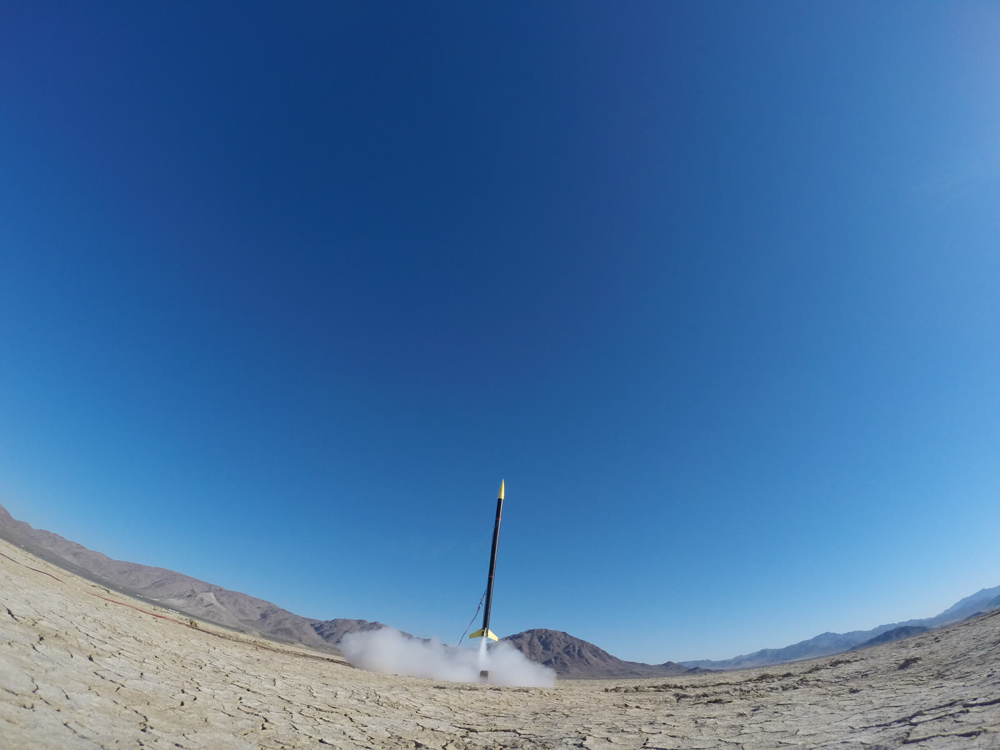
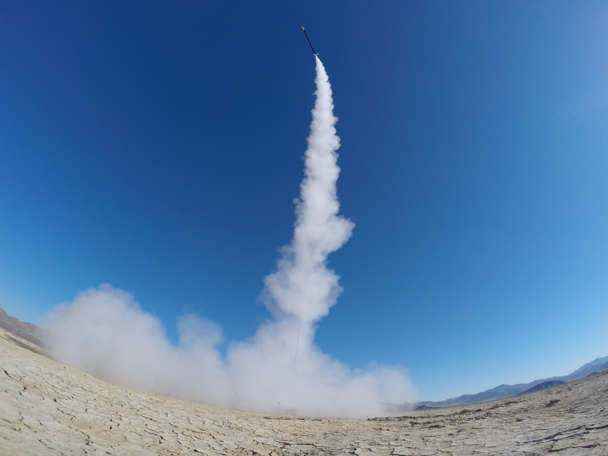

## Overview

In high school, I set out to explore my interest in rocket propulsion by building a large solid
rocket motor. I taught myself the fundamentals from books and online resources, then built the
motor from parts I sourced at Home Depot. Looking back, it was a riskier project than I
appreciated at the time, and I'm glad it worked as well as it did.

With a motor in hand, I needed something to fly it in. Rather than build a test stand, I went
straight to a rocket: large cardboard mailing tubes for the airframe, a plastic nose cone, and fins
cut from wood. At the time, I just wanted the rocket to be tall and look impressive.

<em>* Rocket is 8 feet tall</em>

## Results

Shortly after liftoff, the rocket pitched over and flipped upside down. Still under thrust, it
tumbled through several more flips before the motor burned out and it parachuted back to the
ground. It was a memorable lesson in stability, specifically in how the locations of the center of
gravity (CG) and center of pressure (CP) determine whether a rocket flies straight. One thing I can
conclude: the center of pressure was definitely in front of the center of gravity!
