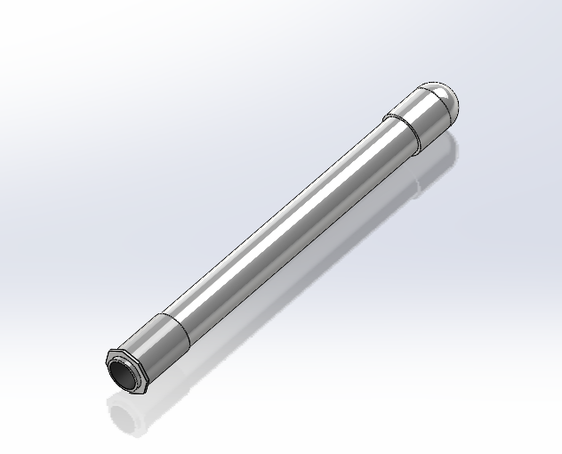
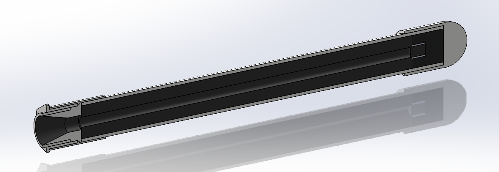
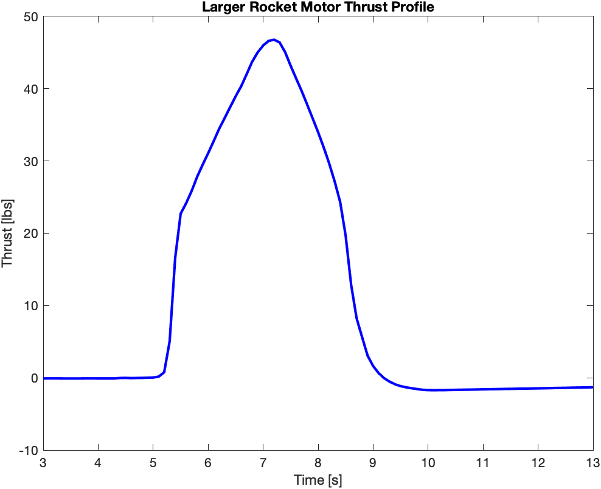

## Overview

<video src="/media/static-fire-thrust-curve-15s.mp4" poster="/media/static-fire-thrust-curve-15s.jpg" width="1280" height="720" controls playsinline preload="none" aria-label="Static fire of a solid rocket motor with its live thrust curve"></video>

My senior project at SDSU was to design, build, and test solid rocket motors and measure their
thrust against theoretical predictions. Under my guidance, my team successfully tested two rocket
motors, the larger of which is shown here.

## Design

The motor casing was built from PVC pipe with a cast cement nozzle, and the propellant grain was a
tubular geometry of potassium nitrate and sugar. Every material in the design was readily available
and relatively inexpensive: two motors, one small and one larger, cost $450 in total. Thrust was
measured with a data acquisition system made up of a load cell, an amplifier board, and an
Arduino-compatible microcontroller.

## Testing & Results

<video src="/media/static-fire.mp4" poster="/media/static-fire.jpg" width="720" height="1280" controls muted loop playsinline preload="metadata" aria-label="Static fire of a solid rocket motor"></video>

<em>Measured thrust curve from the larger motor</em>

