<!-- DRAFT: all text on this page is a stand-in for Trevor to rewrite. -->

## Overview

<video src="/media/tvc-flight4-padcam.mp4" poster="/media/tvc-flight4-padcam.jpg" width="720" height="1280" controls playsinline preload="metadata" aria-label="Pad camera view of the TVC rocket launching from its tower"></video>

<em>Flight 4 liftoff, pad camera view</em>

A thrust-vector-controlled (TVC) rocket maintains stability by gimbaling its motor 
instead of relying on fins. Having no fins means this vehicle is aerodynamically unstable and depends entirely on its flight
computer to stay upright, measuring its orientation 200 times per second and gimbaling the motor to
correct any attitude error.

I started this project in the summer of 2026. My professional work is in structural analysis and I wanted
to dive into some uncharted engineering territory. When I began, I had no background in embedded software or
control systems; the flight computer, its firmware, the control loop, and the launch pad were all
learned and built along the way.

In four test flights so far, the rocket has progressed from a prototype launched off a hobby rail to
a refined vehicle flying from a fully automated launch pad with remote ignition and retracting
tower arms. The sections below follow that progression chronologically, so earlier designs come
first. Development is ongoing, focused on solving a vibration problem,
tuning the controller, and redesigning the parachute ejection system.

## Design

- **Microcontroller:** STM32F411CEU6 programmed in C
- **Sensors:** ISM330DHCX 6-axis IMU (±8 g, ±1000 °/s) and BMP280 barometer
- **Data Logging:** 16 MB SPI flash recording the full vehicle state every control cycle
- **Attitude Estimation:** Quaternion-based Mahony filter
- **Altitude Estimation:** 3-state Kalman filter (altitude, vertical velocity, accelerometer bias)
  fusing IMU and barometer data
- **Control:** PD attitude controller driving a two-axis servo gimbal with ±6° of travel
- **TVC Mount:** BPS.space design (purchased CAD files [here](https://bps.space/products/thrust-vector-control)), driven by
two SG90 servos
- **Flight Logic:** State machine that detects launch, burnout, and apogee, with a backup ejection
  timer
- **Flight Simulation Software:** OpenRocket
- **Recovery:** spring-loaded parachute ejection released by a servo-driven latch
  ([details below](#recovery-system))
- **Post-Flight Tools:** Python decoder that turns binary flash logs into plots and a 3D attitude
  replay
- **Flight Software:** source code on [GitHub](https://github.com/BlazingPlanet/TVC-Flight-Software)

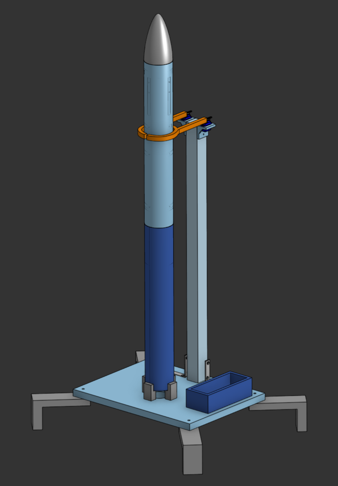

The airframe combines off-the-shelf 74mm tubing with 3D-printed internals: the flight computer sled,
recovery system, and nose cone were all designed and printed in-house.

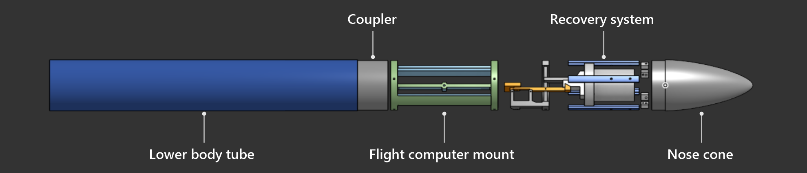

<em>Exploded view of the rocket (TVC mount, servos, and springs not shown)</em>

### Recovery System

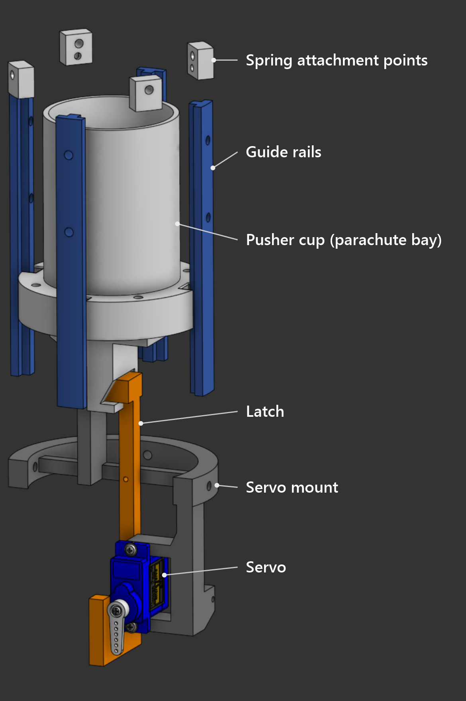

<em>Recovery system (springs not shown)</em>

The first iteration of the recovery system is spring-loaded. Springs stretched between the upper
attachment points and the pusher cup pull the cup forward along the guide rails, pushing the nose
cone off and drawing the parachute out behind it. Until apogee, a latch hooked onto a catch at the
bottom of the pusher cup holds everything closed; at apogee, the servo swings into the latch's hook
arm and releases it.

The system deployed the parachute on flights 1 and 3. On flight 2, a poorly packed parachute
combined with the low apogee left it no time to unfurl. On flight 4, the parachute never deployed even though the flight
log shows the servo actuated, so the release mechanism most likely jammed. That reliability problem
is why the next version moves to pyrotechnic ejection.

## Flight Computer

### V1

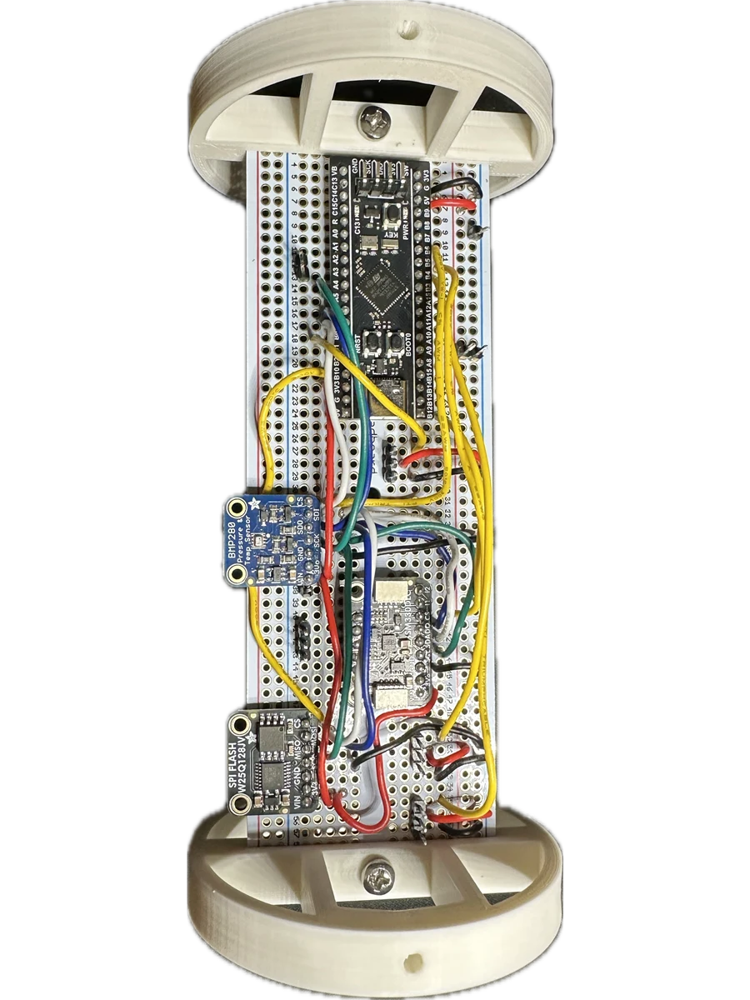

<em>Front</em>

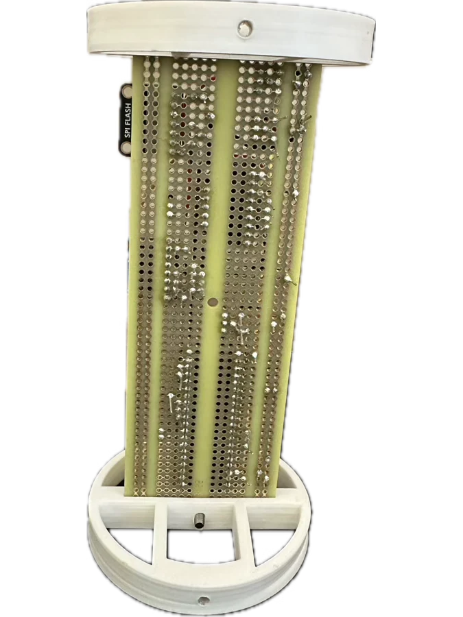

<em>Back</em>

The first flight computer was built on an Adafruit Perma-Proto board, with every component
hand-soldered and wired. It carries the STM32 microcontroller, IMU, barometer, and flash
memory, mounted in a 3D-printed sled. V1 flew on flights 1 and 2. Vibration was corrupting the
gyroscope readings on both flights, but it wasn't suspected until the flight 2 data was reviewed:
the pitch-over on flight 1 had been attributed to the crooked, poorly supported launch rail it flew
from.

### V2

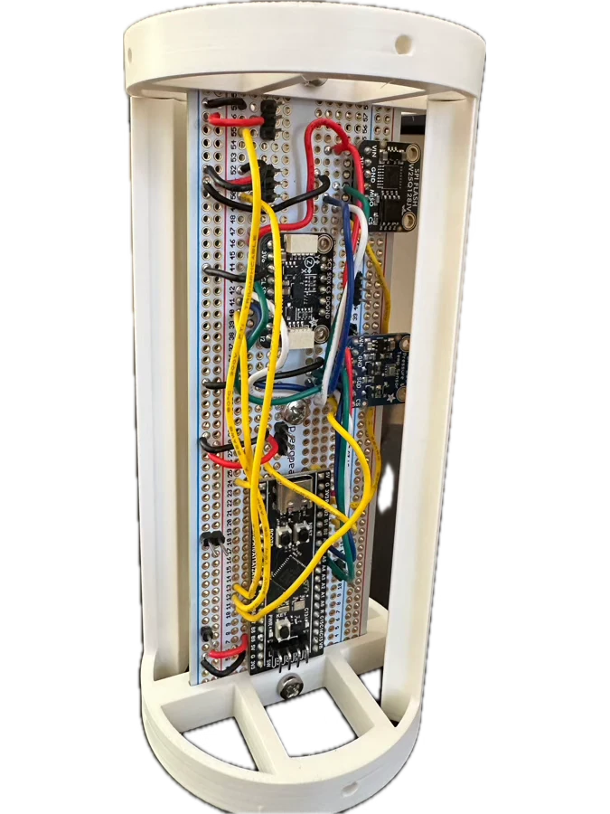

<em>Front</em>

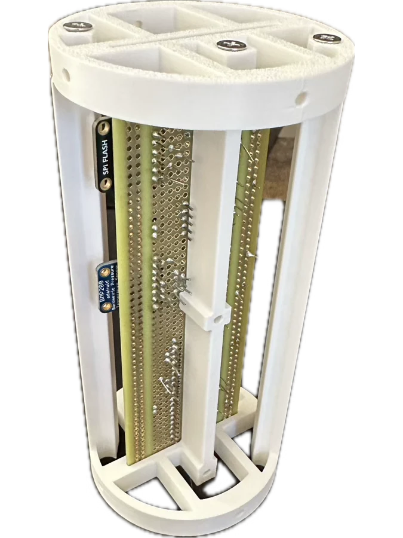

<em>Back</em>

V2 kept the same Perma-Proto board but moved it to a redesigned mount aimed at reducing vibration.
Vertical webs between the top and bottom of the sled stiffen the structure, and a third attachment
point through the middle of the board adds support where V1 had none. V2 flew on flights 3 and 4.
The vibration problem mostly persisted, which is driving the move to a custom PCB with rubber isolation
mounts.

## Flight Tests

### Flight 1

<video src="/media/tvc-flight1.mp4" poster="/media/tvc-flight1.jpg" width="720" height="1280" controls playsinline preload="metadata" aria-label="Flight 1 of the TVC rocket"></video>

The first flight, with flight computer V1 on board, came before the launch pad existed. The
rocket was ignited manually with a handheld launch controller and flew from a commercial
off-the-shelf (COTS) launch rail. The rail was poorly supported and leaned, so the rocket began
its flight already pitched over.

The rocket maneuvered wildly during the burn, and the tilted rail was the obvious suspect. That
explanation was plausible enough that the vibration clearly visible in the gyroscope data went
unnoticed until flight 2.

### Flight 2

<video src="/media/tvc-flight2.mp4" poster="/media/tvc-flight2.jpg" width="720" height="1280" controls playsinline preload="metadata" aria-label="Flight 2 of the TVC rocket at Lucerne Dry Lake"></video>

<em>Prepping for flight 2</em>

The first flight from the automated launch pad. Almost immediately after liftoff, the rocket
pitched over to nearly 90 degrees, recovered, and then continued nearly horizontal. The parachute
deployment sequence fired, but the push was too weak: the parachute never fully cleared the pusher
cup, and the rocket didn't have enough altitude left for it to unfurl.

The flight log revealed two problems. First, the flight computer entered the COAST state about
0.6 seconds before the motor actually burned out, which locked the gimbal at its trim position and
ended corrections early. The burnout-detection thresholds were too easy to trip, and a firmware
update tightening them fixed the problem for later flights. 

Second, and more fundamental, vibration was corrupting V1's gyroscope readings. The body angular
rates in the detail plot below are jagged and noisy throughout the boost phase instead of smooth.
The noise appears just before the BOOST state begins, at motor ignition, which points to the
motor's vibration as the source.
Because the attitude estimate is built from those readings, the logged tilt peaks at only about 30°
early in the flight, while the video shows the rocket pitching over to nearly 90°. The flight
computer was severely underreporting how far the rocket had actually tipped. During the boost
phase, the commanded gimbal deflection also sat at its ±6° limit about 80% of the time on both axes
(the SAT flags). The rocket peaked at about 60 m.

<em>Flight 2 overview, from liftoff through the start of descent. Click to enlarge.</em>

<em>Flight 2 detail: body rates, raw accelerometer, servo commands, and log flags. Click to enlarge.</em>

### Flight 3

<video src="/media/tvc-flight3-tracking.mp4" poster="/media/tvc-flight3-tracking.jpg" width="720" height="1280" controls playsinline preload="metadata" aria-label="Flight 3 of the TVC rocket"></video>

The first flight with flight computer V2. The parachute deployed and the rocket was recovered.

### Flight 4

<video src="/media/tvc-flight4.mp4" poster="/media/tvc-flight4.jpg" width="720" height="1280" controls playsinline preload="metadata" aria-label="Flight 4 of the TVC rocket"></video>

Flown later the same day as flight 3 (the pad camera view is at the top of this page). The
parachute did not deploy and the rocket was destroyed. With the vibration problem still present
and the spring-loaded ejection system working on only two of four flights, this flight set the
direction for the next version.

Flights 3 and 4 flew nearly identically, so the log from flight 3 is shown here. With flight
computer V2, control during the burn was much better than on flight 2: tilt stayed within about
11° of vertical for the entire burn, gimbal saturation dropped from about 80% of the burn to 58%
and 29% on the two axes, and the rocket reached about 77 m. After burnout, with no thrust left to
steer, the rocket tipped to about 70° during coast.

<em>Flight 3 overview, from liftoff through the start of descent. Click to enlarge.</em>

<em>Flight 3 detail: body rates, raw accelerometer, servo commands, and log flags. Click to enlarge.</em>

## What's Next

- **Custom PCB with vibration isolation.** Moving the flight computer from perfboard to a custom
  PCB, mounted on rubber isolators to keep vibration out of the IMU.
- **Pyrotechnic parachute ejection.** Replacing the custom spring-loaded ejection mechanism, which
  was prone to jamming, with a standard pyro-based system.

## Media Gallery

<figure>

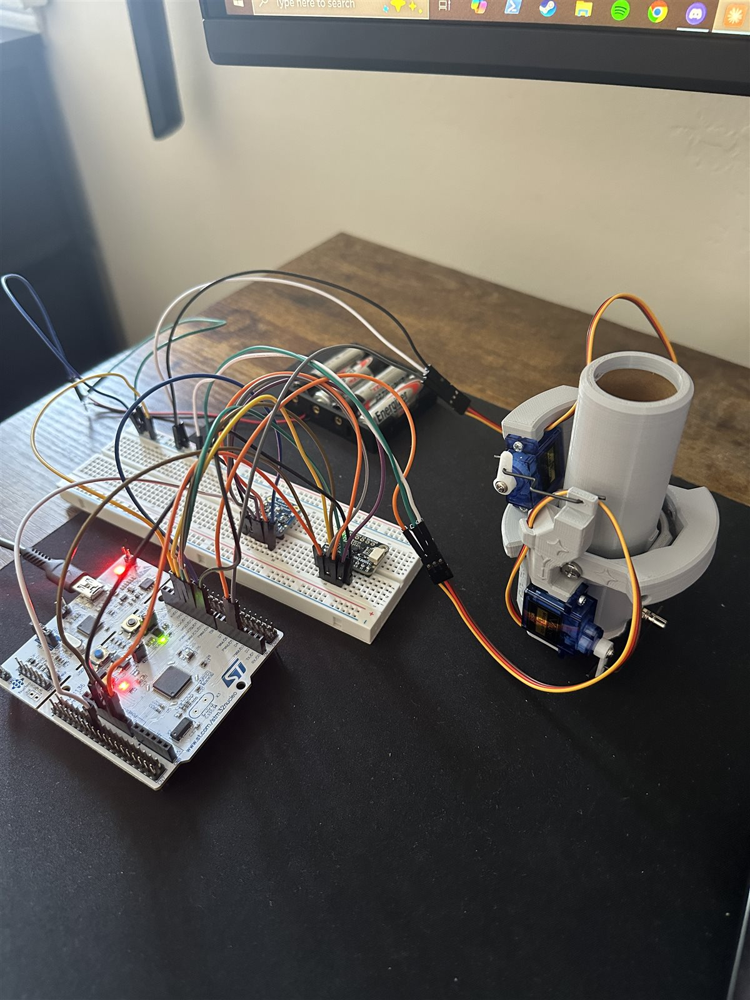

<figcaption>Early bench testing of the TVC mount on an STM32 Nucleo development board</figcaption>
</figure>
<figure>

<figcaption>Bifilar pendulum test to measure the rocket's moment of inertia for controller tuning</figcaption>
</figure>
<figure>

<figcaption>Bifilar pendulum test, second view</figcaption>
</figure>
<figure>

<figcaption>Building the launch pad from aluminum stock in the workshop</figcaption>
</figure>
<figure>

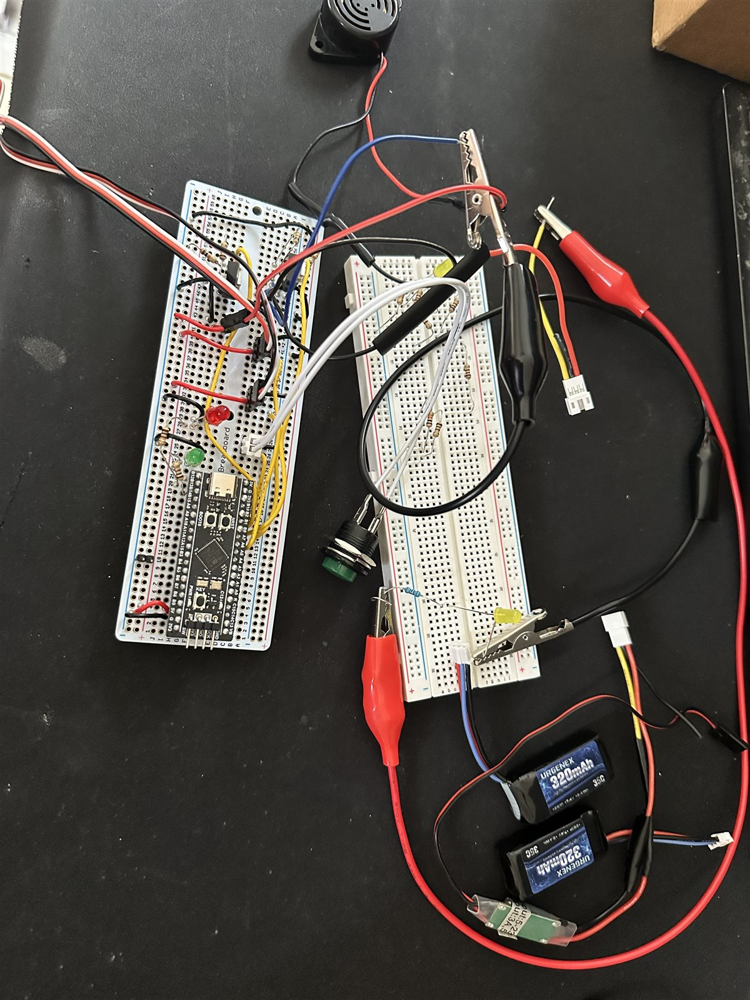

<figcaption>Breadboard prototype of the launch pad electronics</figcaption>
</figure>
<figure>

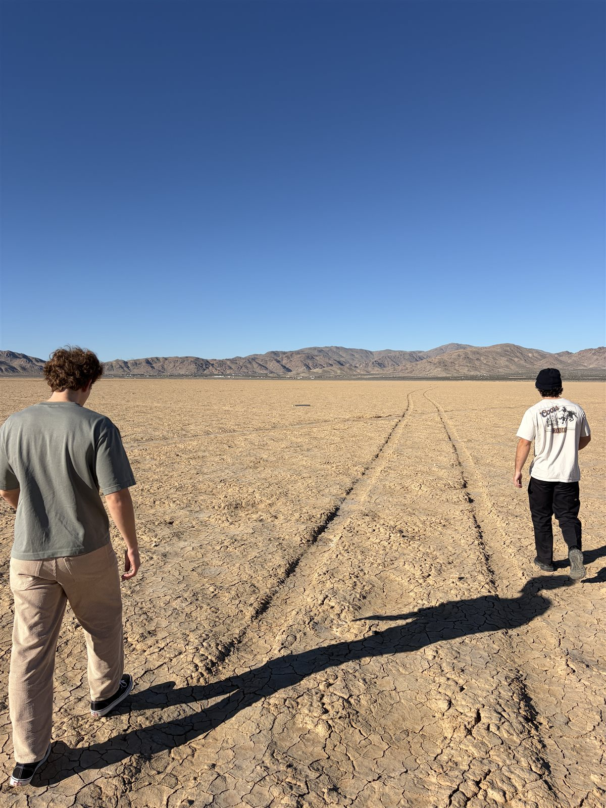

<figcaption>Walking out to the launch site for flight 2</figcaption>
</figure>
<figure>

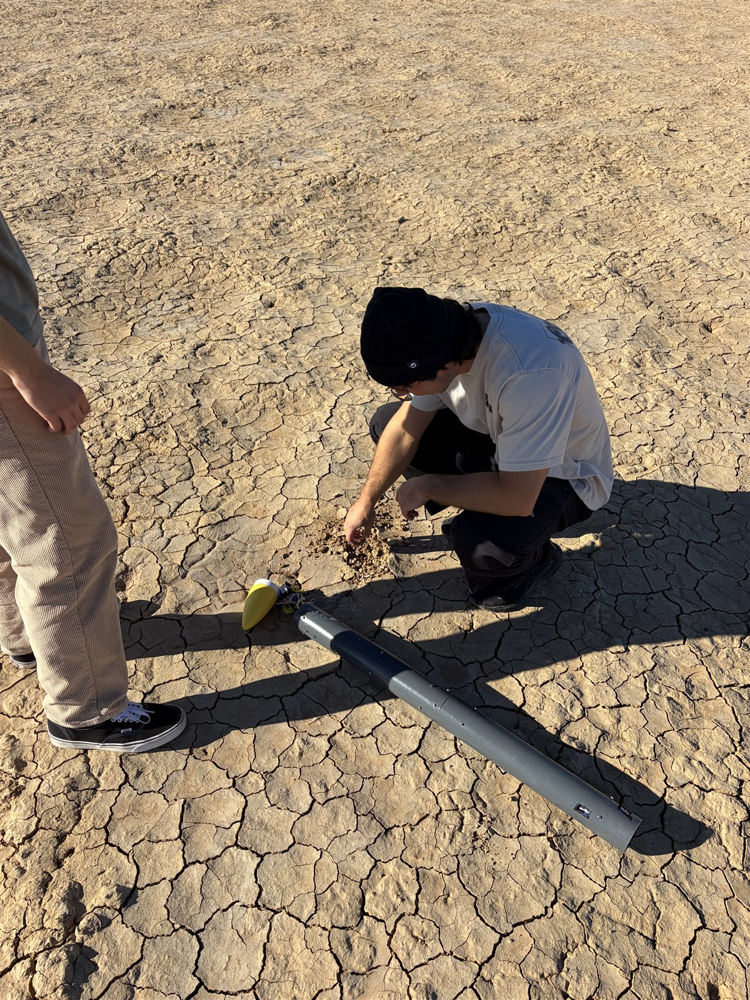

<figcaption>Recovering the rocket after flight 2</figcaption>
</figure>

