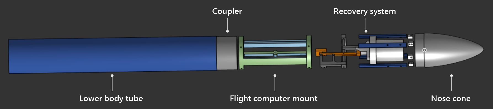
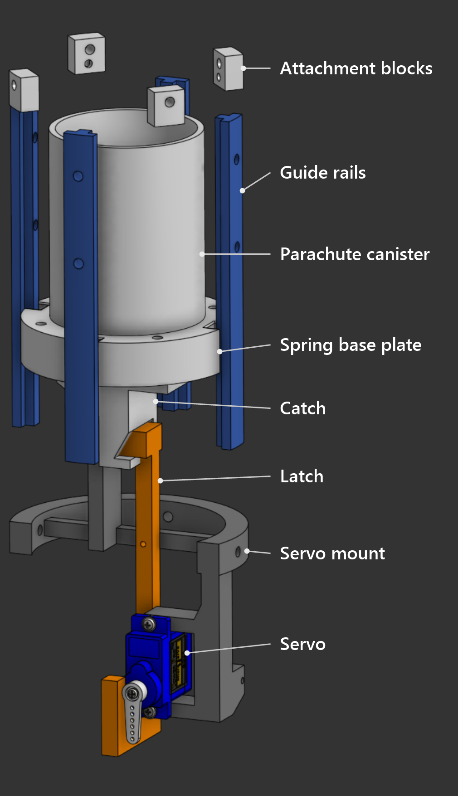
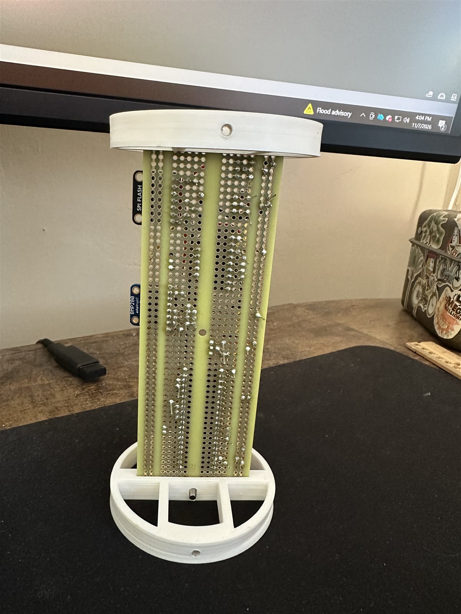
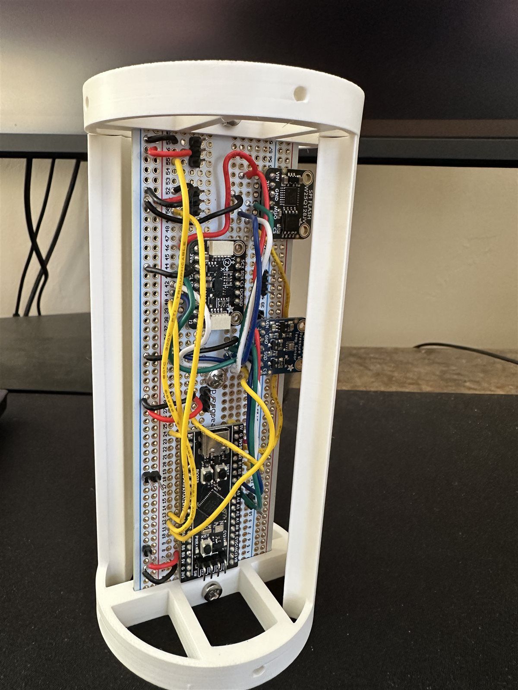
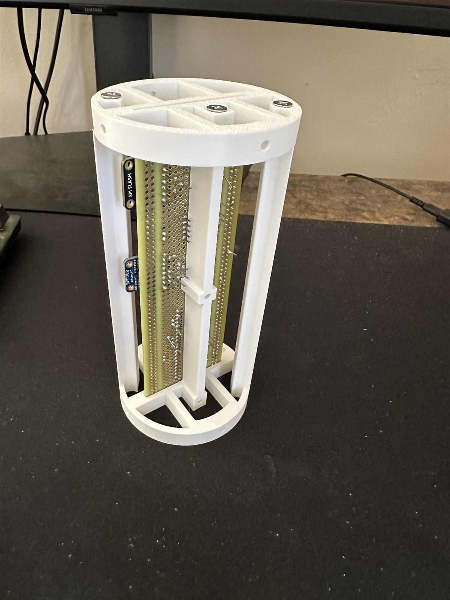
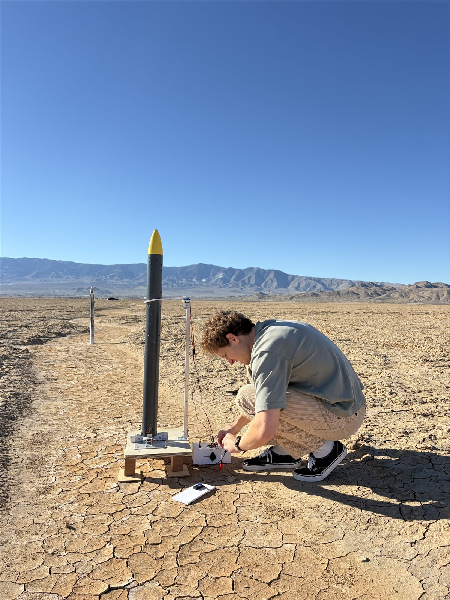
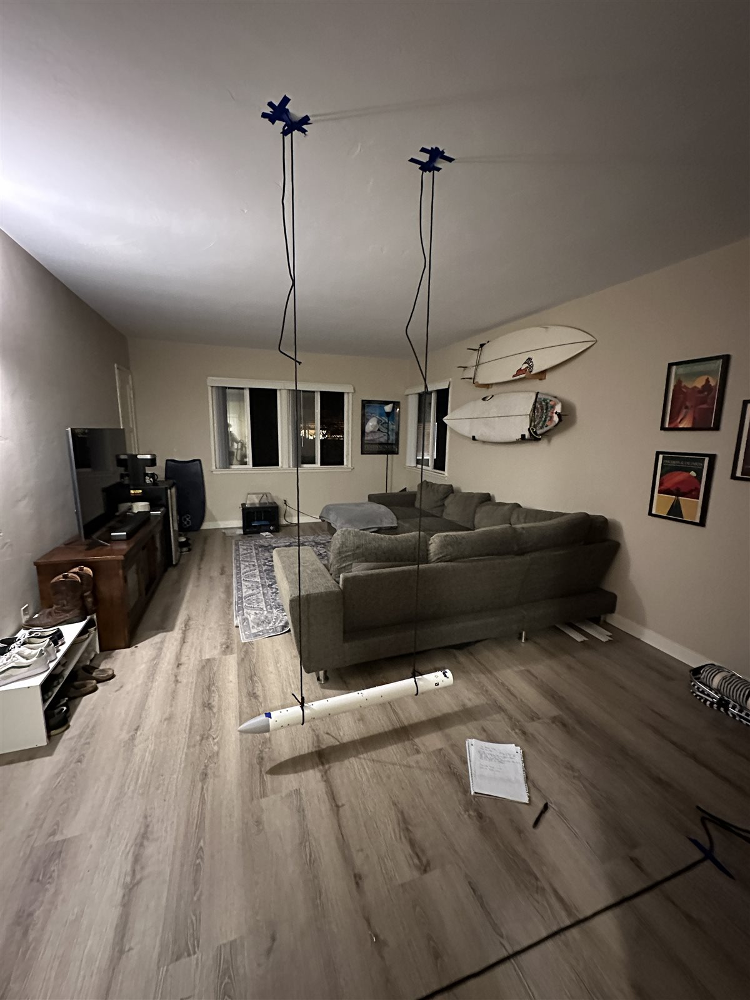
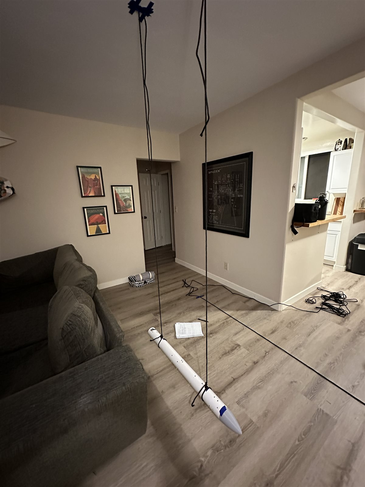
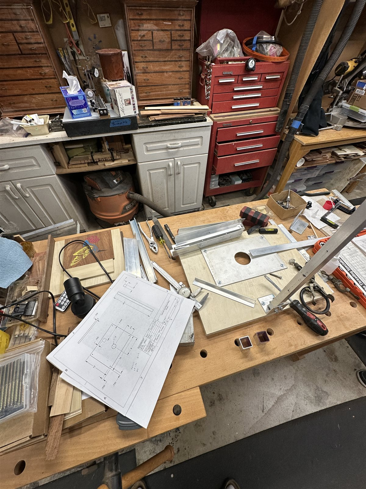

<!-- DRAFT: all text on this page is a stand-in for Trevor to rewrite. -->

<em>This project is in progress. The page will grow as the next version comes together.</em>

## Overview

<video src="/media/tvc-flight4-padcam.mp4" poster="/media/tvc-flight4-padcam.jpg" width="720" height="1280" controls playsinline preload="metadata" aria-label="Pad camera view of the TVC rocket launching from its tower"></video>

This is my most ambitious project so far: an actively stabilized, thrust-vector-controlled rocket
with its own launch system. When I started, I had no background in embedded software or control
systems. The flight computer, its firmware, the control loop, and the launch pad were all learned
and built along the way.

Over four test flights, the rocket has gone from a bare launch rod to a full pad with remote
ignition and a retracting tower arm, and each flight has pointed to what to fix next.

## Design

The rocket steers by vectoring its motor's thrust. A custom flight computer estimates the
rocket's attitude in real time and runs a PD controller to keep it pointed upright, while a flight
state machine detects launch, burnout, and apogee to trigger parachute deployment.

The launch pad has its own computer for remote ignition, a servo-actuated tower arm that retracts
at launch, and pad status indication.

From the bottom up, the rocket is a lower body tube, a coupler, the flight computer mount, the
3D-printed recovery system, and the nose cone.

<em>Exploded view of the rocket (TVC mount, springs, and servo not shown)</em>

<em>Recovery system (springs not shown)</em>

The recovery system is spring-loaded. Springs compressed against the base plate push the nose
cone and parachute canister out along four guide rails. Until then, a latch hooked onto a catch
holds everything closed, and at apogee a servo swings the latch free to release it.

The mechanism deployed the parachute on two of the four flights and was prone to jamming, which is
why the next version moves to pyrotechnic ejection.

## Flight Computer

### V1

<em>Front</em>

<em>Back</em>

The first flight computer was hand-wired on perfboard around an STM32 microcontroller, with an
IMU, a barometer, and flash memory for data logging. In bare-metal C, it ran a Mahony attitude
filter and a 3-state Kalman filter at 200 Hz, fusing IMU and barometer data to estimate
orientation, altitude, and vertical velocity. V1 flew on flights 1 and 2. After flight 2, the
flight data showed that vibration was corrupting the gyroscope readings.

### V2

<em>Front</em>

<em>Back</em>

V2 was a rebuilt board that flew on flights 3 and 4. The vibration problem persisted, which is
driving the move to a custom PCB with rubber isolation mounts.

## Flight Tests

### Flight 1

<video src="/media/tvc-flight1.mp4" poster="/media/tvc-flight1.jpg" width="720" height="1280" controls playsinline preload="metadata" aria-label="Flight 1 of the TVC rocket"></video>

The first flight, launched from a simple rod before the launch pad existed, with flight computer
V1 on board.

### Flight 2

<video src="/media/tvc-flight2.mp4" poster="/media/tvc-flight2.jpg" width="720" height="1280" controls playsinline preload="metadata" aria-label="Flight 2 of the TVC rocket at Lucerne Dry Lake"></video>

<em>Prepping for flight 2</em>

Flown at Lucerne Dry Lake. Shortly after liftoff, the rocket pitched over nearly 90 degrees
before recovering, and the parachute did not deploy. The data from this flight pointed to
vibration corrupting V1's gyroscope readings.

The flight log tells the story of the pitch-over. The commanded gimbal deflection sat at its ±6°
limit for about 80% of the burn on both axes (the SAT flags), and the tilt from vertical kept
growing after burnout. The rocket reached about 60 m, and the ejection command fired after
apogee, but the spring-loaded system did not release the parachute.

<em>Flight 2 overview, from liftoff through the start of descent. Click to enlarge.</em>

<em>Flight 2 detail: body rates, raw accelerometer, servo commands, and log flags. Click to enlarge.</em>

### Flight 3

<video src="/media/tvc-flight3-tracking.mp4" poster="/media/tvc-flight3-tracking.jpg" width="720" height="1280" controls playsinline preload="metadata" aria-label="Flight 3 of the TVC rocket"></video>

The first flight with flight computer V2. The parachute deployed and the rocket was recovered.

### Flight 4

<video src="/media/tvc-flight4.mp4" poster="/media/tvc-flight4.jpg" width="720" height="1280" controls playsinline preload="metadata" aria-label="Flight 4 of the TVC rocket"></video>

Flown later the same day as flight 3 (the pad camera view is at the top of this page). The
parachute did not deploy and the rocket was destroyed. With the vibration problem still present
and the spring-loaded ejection system working on only two of four flights, this flight set the
direction for the next version.

Flights 3 and 4 flew nearly identically, so the log from flight 3 is shown here. With flight
computer V2, control during the burn was much better than on flight 2: tilt stayed within about
11° of vertical for the entire burn, gimbal saturation dropped from about 80% of the burn to 58%
and 29% on the two axes, and the rocket reached about 77 m. After burnout, with no thrust left to
steer, the rocket tipped to about 70° during coast.

<em>Flight 3 overview, from liftoff through the start of descent. Click to enlarge.</em>

<em>Flight 3 detail: body rates, raw accelerometer, servo commands, and log flags. Click to enlarge.</em>

## What's Next

- **Custom PCB with vibration isolation.** Moving the flight computer from perfboard to a custom
  PCB, mounted on rubber isolators to keep vibration out of the IMU.
- **Pyrotechnic parachute ejection.** Replacing the custom spring-loaded ejection mechanism, which
  was prone to jamming, with a standard pyro-based system.

## Media Gallery

<figure>

<figcaption>Bifilar pendulum test to measure the rocket's moment of inertia for controller tuning</figcaption>
</figure>
<figure>

<figcaption>Bifilar pendulum test, second view</figcaption>
</figure>
<figure>

<figcaption>Building the launch pad from aluminum stock in the workshop</figcaption>
</figure>

